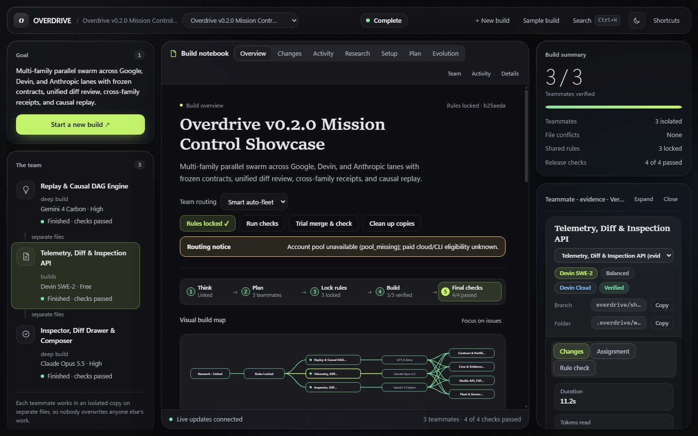
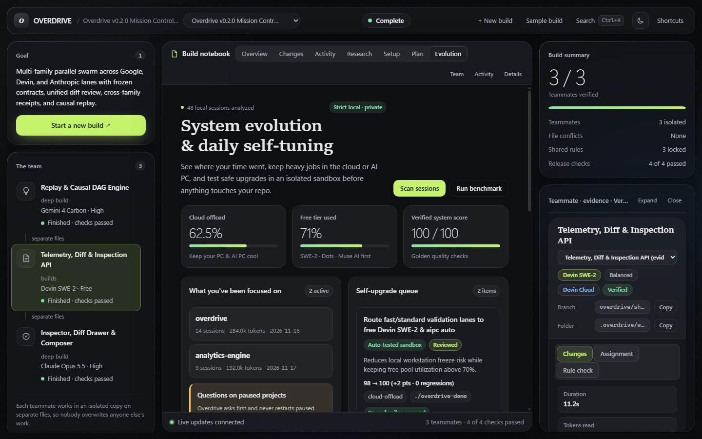

# Overdrive

[](https://nodejs.org/)
[](./package.json)
[](#mcp-tool-reference)
[](./LICENSE)

**Zero-dependency multi-agent build orchestrator.** Combine deep architectural thinking, SHA-256 contract freezing, parallel git worktrees, metric ratchets, cloud compute offloading, and safe local self-improvement — from any MCP-compatible coding agent or the built-in Mission Control Studio.



---

## Why Overdrive?

Running one agent sequentially is slow. Throwing five agents into one repo creates merge conflicts, contract drift, silent regressions, and double-billed retries.

Overdrive separates **thinking**, **contract locking**, **isolated parallel execution**, **independent verification**, and **atomic integration** into a deterministic 7-stage loop — built with **zero npm dependencies** on Node.js 24's built-in `node:sqlite`, `node:http`, and `node:test`.

### The 7-Stage Loop

1. **Pod-Tournament Deep Thinking (`overdrive_pod_plan`)** — Scale architecture sessions from 1 to 40 thinkers using multi-pod tournaments with dedicated trackers and a 4-judge Apex synthesis (integrates natively with [ADHD](https://github.com/OnlyTerp/adhd)).
2. **Disjoint Partition & Seam Extraction (`overdrive_plan`)** — Mechanically prove zero `ownedGlobs` collisions across parallel lanes. When multiple lanes must touch a shared monolith, assign disjoint `ownedRegions` anchors (`startAnchor`/`endAnchor`) so edits merge deterministically.
3. **SHA-256 Contract Freeze & Worktrees (`overdrive_freeze`)** — Lock `HEAD` and SHA-256 digests of every shared contract file, provision isolated git worktrees (`~/.overdrive/worktrees/<repo>/<slug>-<lane>`), isolate per-lane `TEMP`/`TMP` scratch paths, and emit self-contained worker briefs.
4. **Parallel Local & Cloud Swarm (`overdrive_cloud_spawn`, `overdrive_ingest_patch`)** — Dispatch lanes across local harnesses, remote offload (`aipc`), or cloud sandboxes (`claude-cloud`, `codex-cloud`, `devin-cloud`, `devin-vm`, `copilot-cloud`) with pre-dispatch secret scanning, `dryRun` previews, single-attempt spend ledgers, and SHA-256 verified `.patch` ingestion.
5. **Independent Cross-Family Verification & Metric Ratchets (`overdrive_verify`, `overdrive_gate`)** — Audit every lane against `freezeCommit` for contract tampering or out-of-scope edits, evaluate numeric metric ratchets (`OVERDRIVE_METRICS_JSON`, operators `>=`, `<=`, `==`, `delta>=`, `delta<=`, `coverageFloor`), and run coordinator-private holdouts that workers never see.
6. **Atomic Trial-Merge Integration (`overdrive_integrate`)** — Merge verified branches and seam regions inside an isolated `-integrate` worktree, run release gates and private holdouts, and fast-forward `repoRoot` **only if every check passes** (leaving `repoRoot` completely untouched on any failure).
7. **Strict-Local Ratcheted RSI (`overdrive_rsi_*`)** — Mine local session history read-only (`privacyMode: "strict_local"`), run the 5-dimension Golden Benchmark (`checks/rsi-benchmark.mjs`), require an executed cross-family model audit (`modelExecuted: true`), and promote only non-regressing sandbox changes with `prePromoteCommit` rollback receipts.



---

## Quick Start (2 Minutes)

Requires **Node.js >= 24** and **Git** (zero `npm install` needed).

```bash
git clone https://github.com/OnlyTerp/overdrive.git
cd overdrive

# 1. Check detected harnesses, optional offload scripts, and environment health
node bin/overdrive.mjs doctor

# 2. Launch Mission Control Studio (opens http://127.0.0.1:7878 with one-click Sample Build)
node bin/overdrive.mjs studio

# 3. Register the MCP server + skill in your coding harnesses (preview first with --dry-run)
node bin/overdrive.mjs install --dry-run
node bin/overdrive.mjs install --harnesses antigravity,codex,claude,devin
```

You can also link `overdrive` globally (`npm link`) or start the stdio MCP server directly:

```bash
node bin/overdrive.mjs mcp
```

---

## CLI Reference

| Command | Description |
| --- | --- |
| `overdrive mcp [--data <dir>]` | Start the stdio MCP server (`17` tools) |
| `overdrive studio [--port 7878] [--data <dir>]` | Launch Overdrive Mission Control Studio |
| `overdrive doctor` | Inspect detected harnesses, ADHD data, `connect-anything`, offload tools, and routing warnings |
| `overdrive install [--dry-run] [--uninstall] [--harnesses a,b]` | Register MCP config and skill into detected coding harnesses |
| `overdrive validate <topology.json> [--mode ...]` | Mechanically validate zero glob/region overlaps and fleet routing |
| `overdrive status [--data <dir>]` | Print missions from the local SQLite store |
| `overdrive verify-lane --mission <id> --lane <id> [--data <dir>]` | Audit lane scope/contracts and run `verifyCmd` |
| `overdrive integrate --mission <id> [--lanes a,b] [--gate <id>] [--cleanup] [--no-gates] [--no-holdouts] [--no-promote]` | Run atomic trial-merge integration and holdout ratchet |
| `overdrive pod-plan [--goal "..."] [--thinkers 12] [--pod-size 5] [--harness antigravity]` | Plan a 1–40 thinker Pod-Tournament + 4-judge Apex session |
| `overdrive assistants [--role research] [--since <ts>]` | Read live assistant brief merged with account pool freshness |
| `overdrive rsi <scan\|benchmark\|overview> [--data <dir>] [--root <dir>]` | Run strict-local RSI scan, 5-dimension Golden Benchmark, or overview |

---

## MCP Tool Reference

| Tool | Purpose |
| --- | --- |
| `overdrive_status` | Inspect active missions, detected fleet + routing warnings, and optional ADHD sessions or RSI overview |
| `overdrive_create` | Create a mission workspace linked to a git repo, routing mode (`single-harness`, `playbook-auto`, `mix-and-match`), and optional ADHD session |
| `overdrive_plan` | Validate and store `sharedContracts`, disjoint lanes (`ownedGlobs`/`ownedRegions`), metric ratchets, and release gates |
| `overdrive_freeze` | Lock `HEAD` + SHA-256 contract hashes, provision isolated git worktrees, and emit self-contained per-lane briefs |
| `overdrive_verify` | Audit a lane worktree against `freezeCommit` (contract tamper + out-of-scope diff check) and execute `verifyCmd` |
| `overdrive_gate` | Run one required release gate (or all pending/required gates) and optionally clean up worktrees on completion |
| `overdrive_escalate` | Mark a mission escalated and build an observed ADHD `goal_loop_evidence` packet from failed diagnostics |
| `overdrive_integrate` | Run atomic trial-merge integration and holdout ratchet evaluation across verified lanes |
| `overdrive_ingest_patch` | Ingest and SHA-256 verify a `.patch` output from a cloud/VM lane into its worktree, optionally running verification |
| `overdrive_cloud_spawn` | Dispatch a single-attempt cloud/VM lane worker (`claude-cloud`, `codex-cloud`, `devin-cloud`, `devin-vm`, `copilot-cloud`) or preview with `dryRun: true` |
| `overdrive_pod_plan` | Plan a 1–40 thinker Pod-Tournament & Cross-Family Apex ADHD architecture session |
| `overdrive_assistants` | Read live assistant brief & quota windows merged with account pool freshness and select the best eligible assistant for a role |
| `overdrive_rsi_scan` | Mine local read-only intentions (`strict_local`) and run the 5-dimension Golden Benchmark to rank RSI candidates |
| `overdrive_rsi_cycle` | Run a ratcheted verification cycle on an RSI candidate (stays `evaluated_pending_audit` until a real cross-family model audit executes) |
| `overdrive_rsi_audit` | Submit an executed cross-family model audit receipt for an evaluated RSI candidate before promotion |
| `overdrive_rsi_promote` | Promote an audited non-regressing RSI candidate (`applyGitMerge: true` runs isolated trial benchmark + `git merge --ff-only`) |
| `overdrive_rsi_rollback` | Roll back a promoted RSI candidate to its recorded `prePromoteCommit` with an immutable rollback receipt |

---

## Configuration (`~/.overdrive/config.json`)

Out of the box, Overdrive stores all state cleanly under `~/.overdrive/` and `os.tmpdir()/overdrive/` with zero machine-specific setup.

To customize paths or wire optional companion tools (`connect-anything`, remote offload scripts, local session ledgers, or account pools), create `~/.overdrive/config.json` (kept strictly outside your repositories):

```json
{
  "dataDir": "~/.overdrive/data",
  "worktreeRoot": "~/.overdrive/worktrees",
  "scratchDir": "/tmp/overdrive",
  "privateDir": "~/.overdrive/private",
  "cloudLedgerDir": "~/.overdrive/cloud-ledger",
  "adhdDataDir": "~/.adhd/data",
  "connectAnythingBin": "/path/to/connect-anything/bin/connect-anything.mjs",
  "aipcScript": "/path/to/offload-script.py",
  "devinVmBridge": "/path/to/vm-bridge.mjs",
  "accountPoolPath": "~/.overdrive/account_pool.json",
  "teamCliPath": "/path/to/team_cli.py",
  "assistantMcpServer": "assistant-hq",
  "ledgerPath": "~/.overdrive/rsi/ledger.sqlite",
  "memoryPath": "~/.overdrive/rsi/memory.db",
  "driftPath": "~/.overdrive/rsi/drift.json",
  "arpdDir": "~/.overdrive/rsi/research",
  "externalRepoHints": []
}
```

Every setting also has an `OVERDRIVE_*` environment variable override (`OVERDRIVE_HOME`, `OVERDRIVE_CONFIG`, `OVERDRIVE_DATA_DIR`, `OVERDRIVE_WT_ROOT`, `OVERDRIVE_SCRATCH_DIR_BASE`, `OVERDRIVE_LOCK_DIR`, `OVERDRIVE_PRIVATE_DIR`, `OVERDRIVE_CLOUD_LEDGER_DIR`, `OVERDRIVE_ADHD_DATA`, `OVERDRIVE_AIPC_SCRIPT`, `OVERDRIVE_DEVIN_VM_BRIDGE`, `OVERDRIVE_CONNECT_ANYTHING`, `OVERDRIVE_ACCOUNT_POOL`, `OVERDRIVE_TEAM_CLI`, `OVERDRIVE_ASSISTANT_MCP`, `OVERDRIVE_LEDGER_PATH`, `OVERDRIVE_MEMORY_PATH`, `OVERDRIVE_DRIFT_PATH`, `OVERDRIVE_ARPD_DIR`).

Set `OVERDRIVE_IGNORE_USER_CONFIG=1` in CI or sandboxes to ignore `~/.overdrive/config.json` and run purely on portable defaults.

---

## Security & Privacy Guarantees

- **Strict Studio CSP & CSRF Defense**: Mission Control binds strictly to `127.0.0.1`, serves only an explicit static allowlist with `default-src 'self'` (zero `innerHTML`, zero inline scripts/styles, zero external fonts/CDNs), and requires a per-launch `X-Overdrive-Token` plus same-origin header validation on every mutation.
- **Coordinator-Private Holdouts**: Private `holdoutCmd` / `holdoutEnv` / `holdoutMetrics` fields are stripped from worker briefs, SQLite public projections, and UI payloads (`stripPrivateRatchetFields` / `toPublicRatchetSpec`) and stored exclusively under `~/.overdrive/private`.
- **Single-Attempt Cloud Spend Guard**: `overdrive_cloud_spawn` scans briefs and diffs for secrets (`.env`, API keys, multi-line PEM blocks), supports full `dryRun: true` preflight previews, and writes a single-attempt ledger record so billed spawns are never blindly retried without explicit `forceRetry: true`.
- **Honest, Strict-Local RSI**: Intention mining opens local databases read-only, strips emails, home paths, tokens, and raw prompt excerpts before storage, treats paused projects (`>= 72h` quiet) strictly as owner questions (`autoDispatch: false`), blocks protected harness files (`PROTECTED_HARNESS_PATHS`), and refuses promotion unless a real cross-family model audit executed (`audit.modelExecuted === true`).

---

## Testing & Verification

```bash
# Run the full unit, contract, security, API, and 5-dimension Golden Benchmark suite
OVERDRIVE_IGNORE_USER_CONFIG=1 node --test test/*.test.mjs checks/ui-security.mjs checks/studio-api.mjs checks/rsi-benchmark.mjs

# Run headless Chromium/Edge Studio E2E (requires Chrome or Edge installed)
OVERDRIVE_IGNORE_USER_CONFIG=1 node --test checks/studio-browser.mjs
```

---

## License

[Apache-2.0](./LICENSE)
